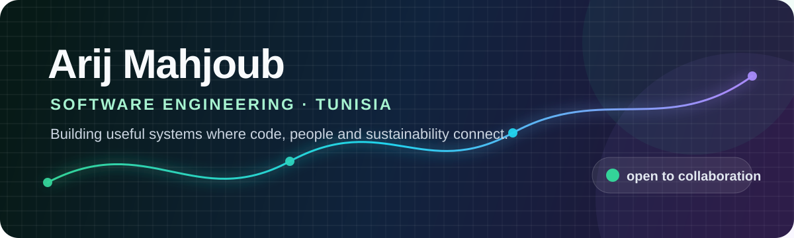
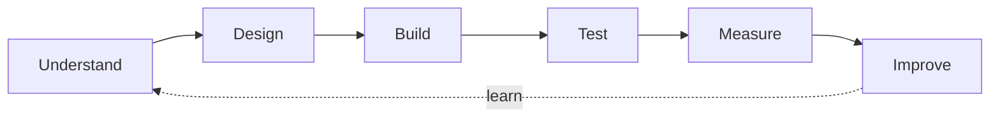

<div align="center">



[](https://github.com/Arij-Mhjb)
[](https://github.com/Arij-Mhjb?tab=followers)
[](https://github.com/Arij-Mhjb/Portfolio)

</div>

## Hello, I'm Arij 👋

I'm a software engineering student in Tunisia who enjoys turning complex ideas into clear, useful products. My work moves across full-stack web development, distributed systems, AI-assisted features and sustainable technology.

```text
Current focus   → traceable, responsible digital products
What I value    → useful UX · clean architecture · measurable quality
How I work      → understand the problem · ship · test · improve
```

## What I'm building

<table>
<tr>
<td width="50%" valign="top">

### ♻️ [TexTileCycle](https://github.com/Arij-Mhjb/TexTileCycle-Platform)

A Laravel platform helping textile brands prepare for ecological labels, trace recovered materials, manage product roadmaps and document evidence.

`Laravel 12` `Blade` `Tailwind CSS` `MySQL` `OpenAI` `Docker` `SonarCloud`

[](https://github.com/Arij-Mhjb/TexTileCycle-Platform/actions)

</td>
<td width="50%" valign="top">

### 🩺 [Medisuiv](https://github.com/Arij-Mhjb/Medisuiv)

An intelligent post-hospital monitoring platform built around microservices and connected health data.

`TypeScript` `Java` `Docker` `JavaScript` `CSS`

</td>
</tr>
<tr>
<td width="50%" valign="top">

### 🌱 [EcoScience](https://github.com/Arij-Mhjb/EcoScience)

A TypeScript project in my growing collection of technology-for-good work.

`TypeScript` `JavaScript` `CSS`

</td>
<td width="50%" valign="top">

### 🏥 [Hospimate](https://github.com/Arij-Mhjb/Hospimate)

A TypeScript application reflecting my interest in useful, human-centered digital services.

`TypeScript` `JavaScript` `CSS`

</td>
</tr>
</table>

## My toolbox

<div align="center">

### Languages & UI


### Frameworks & data


### Delivery & quality


</div>

## The way I engineer



- I connect features to a real user journey.
- I treat tests and static analysis as part of development.
- I document decisions so another developer can continue the work.
- I care about sustainability as both a product goal and an engineering constraint.

## GitHub at a glance

<div align="center">


</div>

## Let's build something meaningful

I'm interested in software that improves how people understand, manage and trust complex systems. Explore my repositories, open an issue on a project, or connect with me here on GitHub.

<div align="center">

**From an idea to a tested product — one thoughtful commit at a time.**

[](https://github.com/Arij-Mhjb)

</div>
